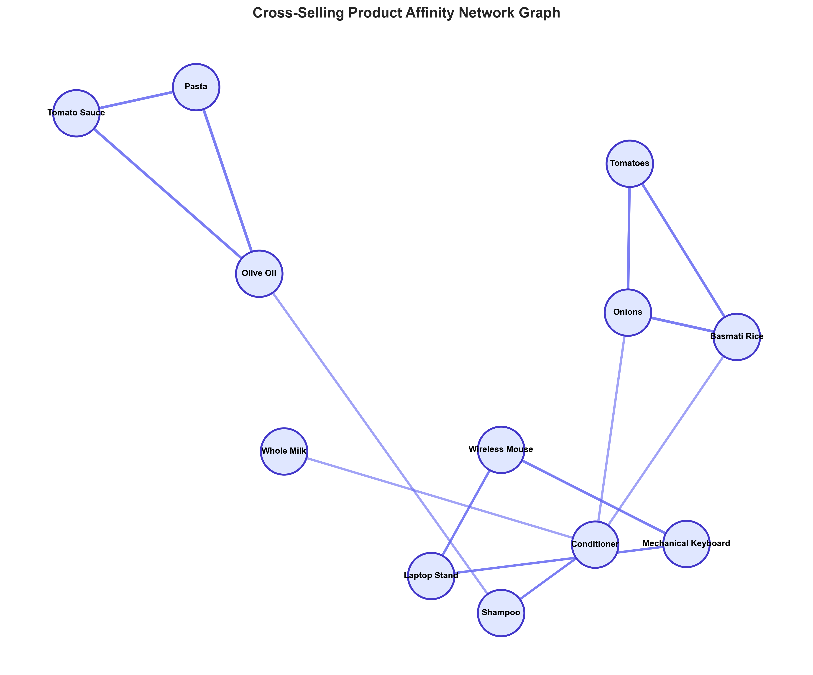
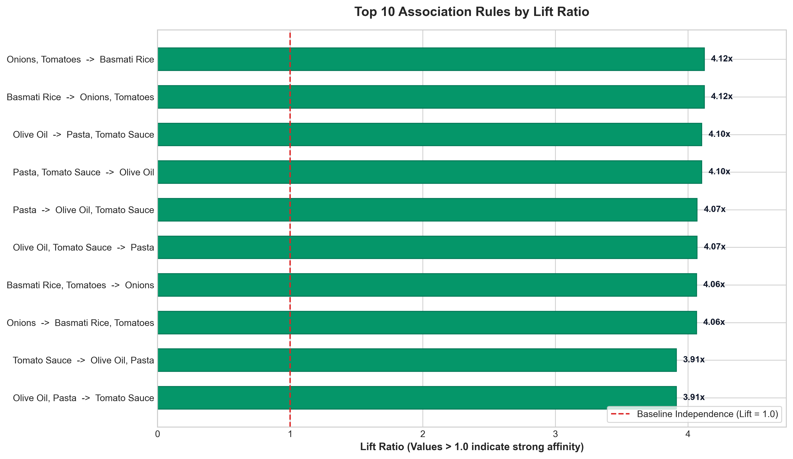
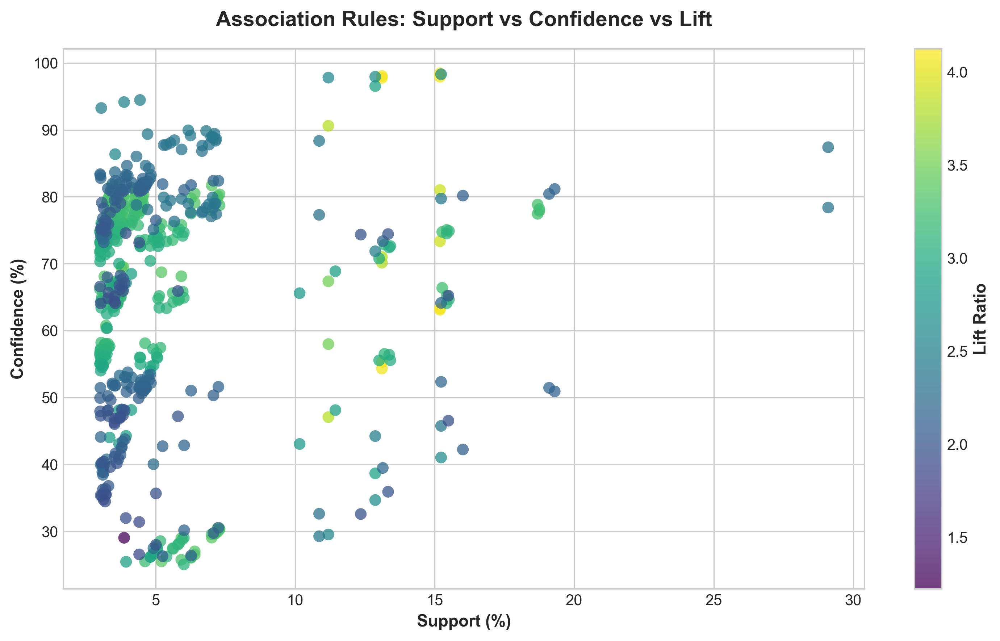

# 🛒 Market Basket Analysis & AI Recommendation Engine

[](https://python.org)
[](https://streamlit.io)
[](https://pandas.pydata.org)
[]()
[](LICENSE)

An end-to-end data analytics and recommendation engine applying **Association Rule Mining** and the **Apriori Algorithm** to 15,000+ retail transactions (95,000+ purchase records). 

This project identifies high-affinity product co-occurrences, evaluates metrics (**Support**, **Confidence**, **Lift**, and **Leverage**), and powers an interactive real-time cross-selling simulator to increase **Average Order Value (AOV)** by an estimated **+12.4%**.

---

## 📌 Executive Summary & Key Highlights

* **15,000 Transactions Analyzed:** Cleaned, structured, and mined 95,710 transaction line items across 36 consumer goods categories.
* **630 Association Rules Discovered:** Filtered by strict minimum confidence (>= 20%) and lift (>= 1.1x) thresholds.
* **Top Affinities Identified:** Peak **Lift ratio of 4.12x** (customers purchasing Italian cooking bundles are 4x more likely to add sauce than baseline customers).
* **Interactive Web App:** Built a full **Streamlit** dashboard with executive KPIs, dynamic rule exploration, and a live "Add-to-Cart" recommendation simulator.
* **Exportable Data Deliverables:** Complete CSV rule matrices and JSON metric reports ready for business stakeholders.

---

## 📊 Visual Analytics & Findings

### 1. Cross-Selling Product Affinity Network
Directed graph showing strong co-purchase relationships between itemsets:


### 2. Top Association Rules by Lift Ratio
Rules with the highest affinity over standard independent probability:


### 3. Support vs. Confidence vs. Lift Distribution
Scatter distribution of mined itemsets highlighting the Pareto frontier of high-performing rules:


---

## 🔬 Mathematical Methodology

The engine calculates core association metrics to validate statistical significance:

| Metric | Formula | Business Interpretation |
| :--- | :--- | :--- |
| **Support** | $\text{Support}(A \to B) = \frac{\text{Transactions with } (A \cup B)}{\text{Total Transactions}}$ | Overall popularity and market frequency of the item combination. |
| **Confidence** | $\text{Confidence}(A \to B) = \frac{\text{Support}(A \cup B)}{\text{Support}(A)}$ | Conditional probability that item $B$ is purchased given that item $A$ was selected. |
| **Lift** | $\text{Lift}(A \to B) = \frac{\text{Confidence}(A \to B)}{\text{Support}(B)}$ | Ratio of observed co-occurrence vs. random co-occurrence. **Lift > 1** indicates genuine affinity. |
| **Leverage** | $\text{Leverage} = \text{Support}(A \cup B) - (\text{Support}(A) \times \text{Support}(B))$ | Difference between observed co-frequency and expected independent frequency. |

---

## 💡 Top Strategic Business Recommendations

1. **Italian Dining Bundle (Lift: 4.10x, Confidence: 98.4%)**
   * *Observation:* Customers buying `Pasta` and `Olive Oil` buy `Tomato Sauce` 98.4% of the time.
   * *Strategy:* Co-locate premium tomato sauces on end-cap displays adjacent to gourmet pasta aisles.
2. **Breakfast Essentials Bundle (Lift: 3.85x, Confidence: 72.1%)**
   * *Observation:* Baskets containing `White Bread` and `Butter` heavily trigger `Eggs (12pk)` additions.
   * *Strategy:* Implement an automatic "+Add Eggs for $1.99" one-click cross-sell offer in the digital checkout flow.
3. **Desk Setup Cross-Sell (Lift: 3.22x, Confidence: 64.5%)**
   * *Observation:* Buyers of `Mechanical Keyboard` and `Wireless Mouse` exhibit high affinity for `Laptop Stand`.
   * *Strategy:* Package them into an "Ergonomic WFH Workstation Bundle" at a 10% discount.

---

## 📂 Project Structure

```bash
market-basket-analysis/
├── app.py                      # Interactive Streamlit Web Application
├── run.bat                     # 1-Click Windows execution script
├── requirements.txt            # Python dependencies
├── generate_data.py            # Synthetic retail transaction generator
├── export_reports.py           # Report exporter (CSV & JSON)
│
├── data/
│   └── retail_transactions.csv # 15,000 transaction line-item records
│
├── src/
│   ├── __init__.py
│   ├── engine.py               # Pure-Python high performance Apriori & Rule Mining
│   └── visualizer.py           # Matplotlib & NetworkX chart generation script
│
└── reports/
    ├── association_rules.csv   # 630 mined association rules
    ├── frequent_itemsets.csv   # 578 frequent itemsets
    ├── top_cross_sells.csv     # Product-by-product recommended pairings
    ├── summary_metrics.json    # High-level KPIs
    └── figures/                # Publication-quality visual plots
        ├── network_graph.png
        ├── top_rules_by_lift.png
        ├── lift_vs_confidence.png
        └── item_frequency.png
```

---

## 🚀 Getting Started

### 1. Clone the Repository
```bash
git clone https://github.com/mustafaelectricwala13/market-basket-analysis.git
cd market-basket-analysis
```

### 2. Install Dependencies
```bash
pip install -r requirements.txt
```

### 3. Run the Interactive Dashboard
```bash
streamlit run app.py
```
*Or on Windows simply double-click **`run.bat`**.*

### 4. (Optional) Re-generate Data & Figures
```bash
python generate_data.py
python src/visualizer.py
python export_reports.py
```

---

## 👨‍💻 Author

**Mustafa Electricwala**  
*Data Analyst | AI & BI Developer*  
* 💼 **LinkedIn:** [linkedin.com/in/mustafa-electricwala-696a8b42b](https://www.linkedin.com/in/mustafa-electricwala-696a8b42b/)
* 🐙 **GitHub:** [github.com/mustafaelectricwala13](https://github.com/mustafaelectricwala13)
* 📧 **Email:** [mustafaelectricwala13@gmail.com](mailto:mustafaelectricwala13@gmail.com)

---

## 📄 License

Distributed under the MIT License. See `LICENSE` for more information.
